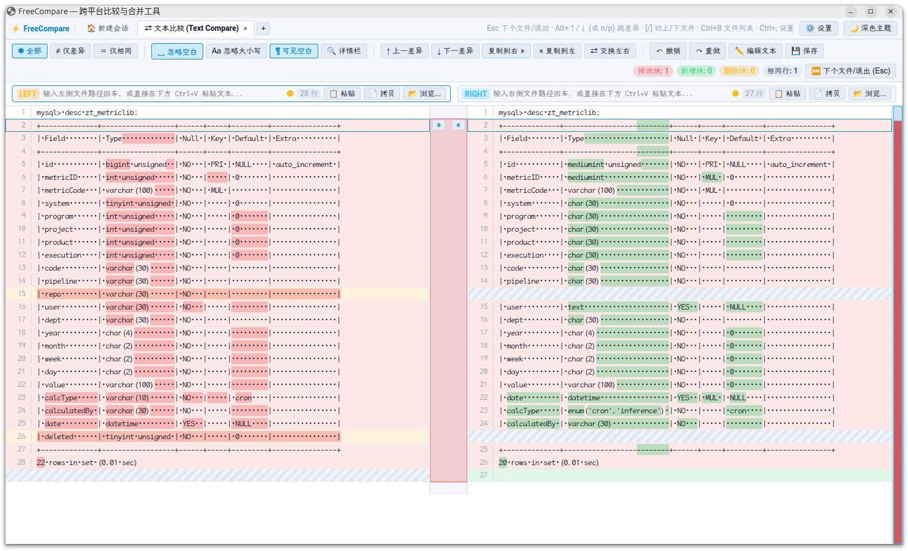

# FreeCompare

[](https://github.com/rayer4u/freecompare/releases)
[](LICENSE)

[Beyond Compare](https://www.scootersoftware.com/)的一种开源免费替代，基于Rust+Tauri技术构建的开源跨平台，面向程序员，选取核心功能，用于文本(代码)、目录比较生产力工具。小巧快速，稳定可靠。

受[OpenCompare](https://github.com/chaxiu/OpenCompare)启发，作为一个老程序员，beyondcompare的资深付费用户，AI变革的参与者，为解决bcompare的能力逐渐落后开发需求问题，探索和AI合作开发能力边界，测试验证AI的快速迭代能力，新建此项目。此项目的AI编程工具是agy cli，模型是Gemini 4，本人仅作为产品经理和使用者。



## 核心特性
1. **自研双栏虚拟滚动引擎 (`VirtualDiffViewport`)**：
   - 定高极速虚拟行池 + 水平/垂直双栏同步滚动 + Gap 斜纹对齐占位行。
   - 中间 Gutter 绘制 **SVG 三次贝塞尔平滑连接色带** 与 `»` / `«` 块复制快捷按钮。
   - 右侧 **Canvas 全局差异鸟瞰图 (Overview Bar)** 与底部 **单行逐字符放大对比详情栏**。
   - 内置 **`Ctrl+F` 内联搜索**（支持双侧/左/右作用域、区分大小写、从当前点击行锚点查找）与 **`Ctrl+G` 行号跳转**。
2. **Rust 高性能核心 (`freecompare-core`)**：
   - 基于 `ropey` + `imara-diff` (Histogram 算法) + `similar` (字符级细粒度二次 Diff)，支持缩进/空行滑块启发式与大差异锚点分治。
   - 自动识别并**保真回写** `UTF-8` / `UTF-8 BOM` / `UTF-16 LE/BE` / `GB18030` 编码与 `LF` / `CRLF` / `CR` 换行符。
3. **文件夹对比与同步 (`FolderDiffView`)**：
   - 支持 **流式 BLAKE3 + `rayon` 并行哈希深度比对** 与 **大小+时间戳快扫模式**。
   - 支持状态过滤、CLI `-filters` 与偏好排除规则联动、跨文件名自由配对对比、目录级左右复制同步、右键确认删除及双击穿透打开文本对比标签页。
4. **三向合并与 Beyond Compare / Git CLI 完全兼容 (`Merge3WayView` & `fcompare` CLI)**：
   - Left / Base / Right 三栏同步滚动 + Merged Output，支持冲突块快捷键跳转（`n`/`p`、`Alt+Up`/`Alt+Down`、`F7`）、一键解决冲突、未决冲突保存确认与 `git difftool` / `git mergetool` 无缝替换 `bcompare`。
5. **AI 编程审查守卫 (`fcompare guard` 原生集成)**：
   - 专为新一代 Agentic AI 工具设计的改动审查机制，目前已适配 Antigravity CLI (agy)。
   - 在 AI 执行写文件与代码编辑时自动弹出双栏只读比对窗口，直观呈现 AI 的修改提议，支持“通过审查”与“拒绝修改”双向操作闭环。
   - 纯 Rust 单二进制原生实现，零外部脚本与胶水依赖，全平台（Linux / macOS / Windows）即开即用。

## 与 Beyond Compare 功能对比

FreeCompare 聚焦**程序员高频刚需**（代码/文本对比、目录比对同步、三向合并、SFTP、Git 与 AI 审查），不追求大而全的非代码格式支持：

| 功能维度 | FreeCompare | Beyond Compare (Standard / Pro) |
| :--- | :--- | :--- |
| **授权与分发** | ✅ **MIT 开源免费**，单文件即开即用 | 商业付费（三向合并、SFTP 需 Pro 版） |
| **双栏文本对比** | ✅ 支持（偏代码对齐、平滑差异连接线、编码与换行符保真） | ✅ 支持（自定义语法与重要/次要规则更丰富） |
| **三向合并** | ✅ **内置** | Standard ❌ / Pro ✅ |
| **文件夹比对与同步** | ✅ 支持内容/元数据对比、批量同步与跨文件名配对 | ✅ 支持，另含镜像预览与定时脚本任务（更丰富） |
| **远程协议** | ✅ **内置 SFTP**、站点管理、加密保存密码与 `~/.ssh/config` 直连 | Standard 仅 FTP / Pro 支持 SFTP、FTPS、WebDAV 与云盘 |
| **Git / CLI 兼容** | ✅ 兼容 `bcompare` 参数与 `-qc`，支持 `--install-git` 一键接入与 `--cli` 终端摘要 | ✅ 支持 CLI 与 Git difftool/mergetool |
| **AI 编程审查守卫** | ✅ **原生支持**（AI 改文件前弹窗审查，一键通过/拒绝） | ❌ 无 |
| **非文本扩展格式** | ❌ 暂不支持（聚焦代码与目录） | ✅ 支持图片、Hex、表格、PDF、音频等 |

## 编译与安装 Release 命令行 (`fcompare`)

`fcompare` 在编译时会自动将前端 `ui/dist` 静态资源**直接内嵌打包进单一可执行文件中**（Single-Binary Zero-Dependency），因此无论从 GitHub Release 下载还是本地编译，只需一个 `fcompare`（或 `fcompare.exe`）单文件即可在任意目录独立运行：

```bash
# 1. 构建前端 UI 静态产物
npm --prefix ui run build

# 2. 编译并安装内嵌 UI 的单文件 Release 版 fcompare 到 PATH (~/.cargo/bin/fcompare)
cargo install --path crates/cli --locked --force

# 3. 一键配置 Git 的 difftool 与 mergetool 替换 bcompare（支持 Linux / macOS / Windows）
fcompare --install-git
```

### Release 各版本区别

| 压缩包 | 产物 | 运行方式与依赖 | 适用场景 |
| :--- | :--- | :--- | :--- |
| `freecompare-windows-x86_64-desktop.zip` | `FreeCompare.exe` | **Tauri 原生窗口**（使用 Windows 10/11 内置 Edge WebView2，**不依赖外部浏览器**，不支持 Win7） | 偏好独立原生桌面窗口、不希望依赖 Chrome/Edge 进程的 Windows 用户 |
| `freecompare-windows-x86_64.zip` | `fcompare.exe` | **CLI + 外部浏览器 App 模式**（本地 HTTP 服务并拉起 Chrome/Edge `--app`） | `git difftool` / `mergetool`、`-qc`、`--cli` 终端摘要及日常命令行比对 |
| `freecompare-linux-x86_64.tar.gz` | `fcompare` | **CLI + 外部浏览器 App 模式**（纯静态/最小依赖，无需安装 `webkit2gtk`） | Linux 桌面与服务器终端（支持 `--cli` 与 `--no-open-window`） |
| `freecompare-macos-arm64.tar.gz` / `x86_64.tar.gz` | `fcompare` | **CLI + 外部浏览器 App 模式** | Apple Silicon / Intel Mac 终端与 Git 集成 |

## AI 编程审查守卫 (Antigravity CLI / agy 集成)

FreeCompare 提供了原生的 `fcompare guard` 命令，用作 Antigravity (agy) 的生命周期钩子（Lifecycle Hooks），在 AI 试图修改文件前进行可视化审查与守卫。

### 1. 配置项目的 `.agents/hooks.json`

在任意项目根目录的 `.agents/hooks.json` 中配置守卫（可将 `"enabled"` 设为 `false` 临时关闭）：

```json
{
  "fcompare-guard": {
    "enabled": true,
    "PreToolUse": [
      {
        "matcher": "edit_file|write_file",
        "hooks": [
          {
            "type": "command",
            "command": "fcompare guard",
            "timeout": 300
          }
        ]
      }
    ]
  }
}
```

### 2. 审查交互工作流

当 AI 工具调用 `write_file` 或 `edit_file` 时：
1. FreeCompare 自动唤起审查窗口：
   - **左侧**：磁盘当前实际文件内容（只读）；
   - **右侧**：AI 提议修改后的新内容。
2. 开发者拥有清晰明确的操作通道：
   - **✅ 通过审查**（点击顶部或工具栏右侧按钮，或按快捷键 `Esc`）：返回退出码 `0`，向 agy 汇报 `{"decision": "allow"}`，AI 修改正式写入磁盘；
   - **❌ 拒绝修改**（点击顶部或工具栏右侧按钮，或按快捷键 `Shift+Esc`）：返回退出码 `1`，向 agy 汇报 `{"decision": "deny"}`，直接拦截并丢弃 AI 的修改。
3. 审查守卫内置了安全白名单保护（自动放行 `.git/`、`.agents/` 等系统配置），杜绝死锁。

## 快速运行指南

```bash
# 1. 运行前端单元测试与 Rust 全工作区测试
npm --prefix ui test
cargo test --workspace

# 2. 直接通过命令行唤起 UI 窗口对比目录、文件或空白新建会话
fcompare
fcompare crates/core crates/cli
fcompare Cargo.toml README.md

# 3. 仅在终端输出统计摘要（不弹窗）或执行静默退出码比对 (-qc)
fcompare Cargo.toml README.md --cli
fcompare -qc Cargo.toml README.md
```

## 界面与交互设计原则

FreeCompare 的所有视图与交互演进严格遵循以下设计准则（开发与设计 UI 时必须参照）：

### 1. 核心设计准则
- **如无必要，勿增控件**：凡高亮框、颜色、图标、快捷键或右键菜单已能清晰表达的状态与操作，绝不往主视图中堆叠额外文字徽标、行内裸按钮或常驻提示条。
- **对齐 Beyond Compare 直觉**：常规点击、焦点切换与快捷键行为直接对齐 `bcompare`（例如目录比对采用单侧单焦点、支持 `Ctrl/Cmd` 同侧或跨侧多选），不自创复杂状态。
- **主视口布局零跳动**：禁止在文件列表或代码视图上方动态插入/移除操作横幅，避免挤压主视口高度导致误点击。

### 2. 新增元素三步客观判定树
准备新增任何提示或操作入口时，按以下顺序客观判定归属（互斥不重叠）：
1. **它是“不可点击的纯信息”吗？**
   - 需要持续查看（编码、换行符、差异统计、行列号）→ **状态栏**
   - 仅需瞬时感知的结果或报错（已保存、连接成功/失败）→ **Toast**
   - 否（它是可触发的操作）→ 进入第 2 步
2. **它会删除或整目录覆盖磁盘数据吗？**
   - 是 → **只能进右键菜单**（并配模态二次确认），严禁放主界面或行内裸按钮
   - 否 → 进入第 3 步
3. **不选中列表里的具体项，这个操作有意义吗？**
   - 没有意义（依赖选中项，如「比较到...」「比较已选两项」「新标签打开子目录」）→ **默认进右键菜单**（仅最核心入口可复用工具栏固定按钮）
   - 有意义（作用于整个视图，如刷新、过滤、忽略空格、查找、保存）→ **工具栏按钮**

### 3. 八类交互与提示区职责边界

| 区域 | 唯一职责 | 严禁越界（红线） |
| :--- | :--- | :--- |
| **高亮框 / 颜色 / 图标** | 表达选中态、增删改差异、文件类型/远程标识 | 已有高亮框时，禁止再叠文字徽标 |
| **状态栏** | 只读、需持续查看的上下文元信息（编码、换行符、差异数） | 禁止放会跳动、需点击的交互横幅 |
| **Toast** | 瞬时结果反馈或非阻塞报错（已保存、读取失败） | 禁止放需长久查看的信息或普通点击每次都弹 |
| **Tooltip (`title`)** | 鼠标悬停解释图标按钮含义与快捷键 | 禁止放必看报错或核心操作说明 |
| **工具栏按钮** | 不依赖选中项的全局视图操作或开关（刷新、过滤、保存） | 禁止放删除/整目录覆盖等高危动作 |
| **右键菜单** | 依赖当前选中项的操作，或删除/整目录覆盖等高危操作 | 禁止放全局偏好设置 |
| **模态确认框** | 不可逆或高风险动作前的阻断确认（删除、带冲突保存） | 普通提示或可 `Ctrl+Z` 撤销的操作禁止打断 |
| **内联输入浮层** | 需连续键盘输入的临时工具（如 `Ctrl+F`/`G`），须支持 `Esc` 优先关闭 | 未主动呼出时不可常驻，不得挤动主列表 |

## 工程与架构规范

本项目遵循严格的跨平台与自包含规范，详见 [AGENTS.md](AGENTS.md)。

## 发版与自动化发布

仓库通过两个独立的 GitHub Actions 工作流完成持续集成与发版：

- **日常 CI（[`.github/workflows/ci.yml`](.github/workflows/ci.yml)）**：监听 `main` 分支推送与 Pull Request，在 Linux / Windows / macOS 三端执行前端测试、前端构建与 `cargo test --workspace`。
- **自动发版（[`.github/workflows/release.yml`](.github/workflows/release.yml)）**：仅在推送 `v*` 版本 Tag（或手动 `workflow_dispatch`）时触发，避免分支推送与 Tag 推送同时触发两次发布；测试通过后自动交叉编译全平台产物并创建 GitHub Release。

标准发版流程详见 [AGENTS.md](AGENTS.md) 第 7 节（同步版本号 → 全量测试与本地安装 → 线性提交 → 创建附注 Tag `vX.Y.Z` → 推送 `git push && git push origin vX.Y.Z`）。

## 许可证 (License)

本项目基于 [MIT License](LICENSE) 开源。
