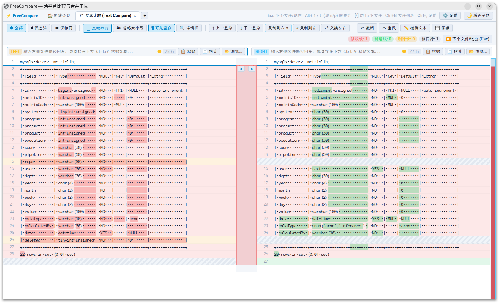

# FreeCompare

对标 Beyond Compare，全新构建的开源跨平台（Windows / macOS / Linux），AI友好的文件对比、双向/三向合并与目录同步工具。受[OpenCompare](https://github.com/chaxiu/OpenCompare)启发，作为一个老程序员，beyondcompare的资深付费用户，AI变革的参与者，为解决bcompare的能力逐渐落后开发需求问题，探索和AI合作开发能力边界，测试验证AI的快速迭代能力，新建此项目。此项目的AI编程辅助工具是agy cli，模型是Gemini 4 Argon，effort默认low。



## 核心特性
1. **自研双栏虚拟滚动引擎 (`VirtualDiffViewport`)**：
   - 定高极速虚拟行池 + 水平/垂直双栏同步滚动 + Gap 斜纹对齐占位行。
   - 中间 Gutter 绘制 **SVG 三次贝塞尔平滑连接色带** 与 `»` / `«` 块复制快捷按钮。
   - 右侧 **Canvas 全局差异鸟瞰图 (Overview Bar)** 与底部 **单行逐字符放大对比详情栏**。
2. **Rust 高性能核心 (`freecompare-core`)**：
   - 基于 `ropey` + `imara-diff` (Histogram 算法) + `similar` (字符级细粒度二次 Diff)。
   - 自动识别 `UTF-8` / `UTF-8 BOM` / `UTF-16 LE/BE` / `GB18030` 编码与 `LF` / `CRLF` 换行符。
3. **文件夹对比与同步 (`FolderDiffView`)**：
   - 支持 **BLAKE3 内容哈希深度比对** 与 **大小+时间戳快扫模式**。
   - 支持状态过滤（全部 / 仅差异 / 仅孤立项 / 仅相同）与双击直接穿透打开文本对比标签页。
4. **三向合并与 Beyond Compare / Git CLI 完全兼容 (`Merge3WayView` & `fcompare` CLI)**：
   - 四窗格三向合并（Left / Base / Right + Merged Output），支持一键解决冲突与 `git difftool` / `git mergetool` 无缝替换 `bcompare`。
5. **AI 编程审查守卫 (`fcompare guard` 原生集成)**：
   - 专为新一代 Agentic AI 工具设计的改动审查机制， 目前已适配Antigravity CLI (agy) 。
   - 在 AI 执行写文件与代码编辑时自动弹出双栏比对窗口，直观呈现 AI 的修改提议，支持“通过审查”与“拒绝修改”双向操作闭环。
   - 纯 Rust 单二进制原生实现，零外部脚本与胶水依赖，全平台（Linux / macOS / Windows）即开即用。

## 编译与安装 Release 命令行 (`fcompare`)

`fcompare` 在编译时会自动将前端 `ui/dist` 静态资源**直接内嵌打包进单一可执行文件中**（Single-Binary Zero-Dependency），因此无论从 GitHub Release 下载还是本地编译，只需一个 `fcompare`（或 `fcompare.exe`）单文件即可在任意目录独立运行：

```bash
# 1. 构建前端 UI 静态产物
npm --prefix ui run build

# 2. 编译并安装内嵌 UI 的单文件 Release 版 fcompare 到 PATH (~/.cargo/bin/fcompare)
cargo install --path crates/cli --locked --force

# 3. 一键配置 Git 的 difftool 与 mergetool 替换 bcompare（支持 Linux / macOS / Windows）
fcompare --install-git
```

## AI 编程审查守卫 (Antigravity CLI / agy 集成)

FreeCompare 提供了原生的 `fcompare guard` 命令，用作 Antigravity (agy) 的生命周期钩子（Lifecycle Hooks），在 AI 试图修改文件前进行可视化审查与守卫。

### 1. 配置项目的 `.agents/hooks.json`

在任意项目根目录的 `.agents/hooks.json` 中配置守卫：

```json
{
  "hooks": {
    "pre_write_file": {
      "command": "fcompare guard"
    },
    "pre_edit_file": {
      "command": "fcompare guard"
    }
  }
}
```

### 2. 审查交互工作流

当 AI 工具调用 `write_file` 或 `edit_file` 时：
1. FreeCompare 自动唤起审查窗口：
   - **左侧**：磁盘当前实际文件内容（只读）；
   - **右侧**：AI 提议修改后的新内容。
2. 开发者拥有清晰明确的操作通道：
   - **✅ 通过审查**（点击顶部或工具栏右侧按钮，或按快捷键 `Esc`）：返回退出码 `0`，向 agy 汇报 `{"decision": "allow"}`，AI 修改正式写入磁盘；
   - **❌ 拒绝修改**（点击顶部或工具栏右侧按钮，或按快捷键 `Shift+Esc`）：返回退出码 `1`，向 agy 汇报 `{"decision": "deny"}`，直接拦截并丢弃 AI 的修改。
3. 审查守卫内置了安全白名单保护（自动放行 `.git/`、`.agents/` 等系统配置），杜绝死锁。

## 快速运行指南

```bash
# 1. 运行 Rust 核心引擎与 CLI 全量测试
cargo test --workspace

# 2. 直接通过命令行唤起 UI 窗口对比目录、文件或空白新建会话
fcompare
fcompare crates/core crates/cli
fcompare Cargo.toml README.md

# 3. 仅在终端输出统计摘要（不弹窗）或执行静默退出码比对 (-qc)
fcompare Cargo.toml README.md --cli
fcompare -qc Cargo.toml README.md
```

## 工程与架构规范

本项目遵循严格的跨平台与自包含规范，详见 [AGENTS.md](AGENTS.md)。
